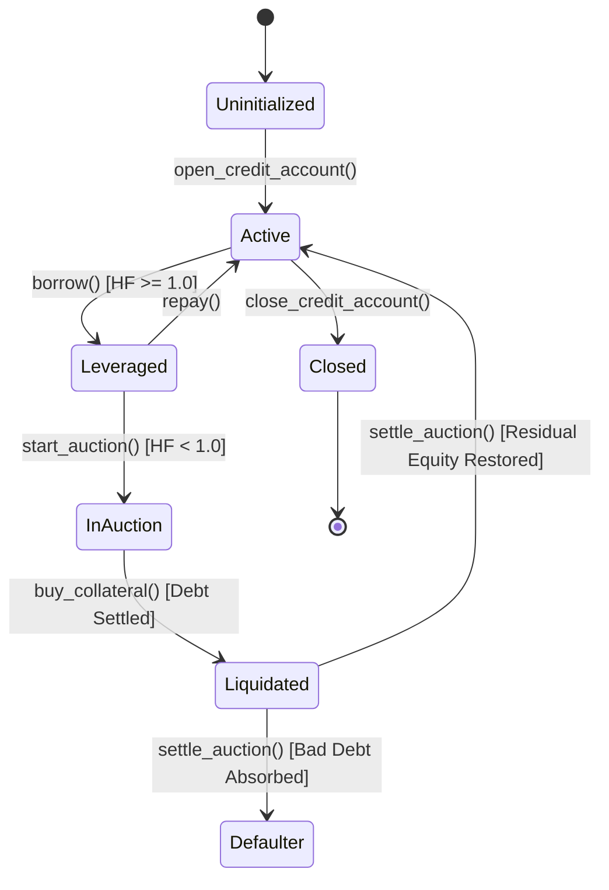
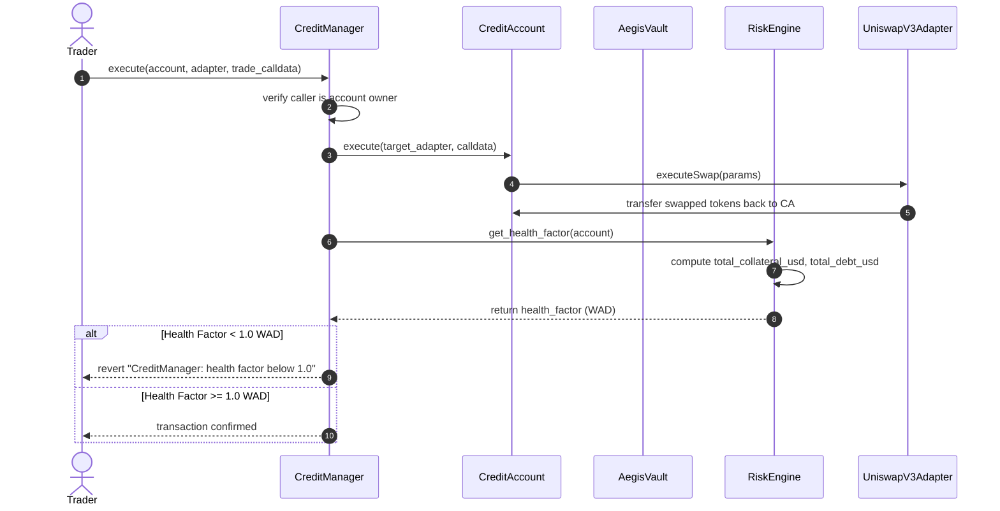

# Aegis Protocol Architecture

Aegis is an onchain decentralized prime brokerage and frequent batch auction clearinghouse built natively in Vyper 0.4.3. The protocol allows institutional and programmatic traders to access multi-asset undercollateralized leverage within strictly isolated proxy accounts, backed by real-time risk accounting, dynamic haircut modeling, and tranche-structured debt capital.

```
                              +---------------------------------------+
                              |         EmergencyCouncil &            |
                              |         ProtocolParameters            |
                              +---------------------------------------+
                                                  |
                                                  v
   +-------------------+              +-----------------------+              +---------------------+
   |    Liquidity      |  deposits    |       AegisVault      |  borrows     |    CreditManager    |
   |    Providers      | -----------> |   (Multi-Asset Pool)  | <----------- |   (Lifecycle Hub)   |
   +-------------------+              +-----------------------+              +---------------------+
                                                  ^                                     |
                                                  | waterfall                           | creates /
                                                  v distribution                        | routes
                                      +-----------------------+                         v
                                      |       DebtEngine      |              +---------------------+
                                      |   (Tranche Waterfall) |              |    CreditAccount    |
                                      +-----------------------+              |   (Isolated Proxy)  |
                                                                             +---------------------+
                                                                                        |
                                  +-----------------------------------------------------+
                                  |                     |                               |
                                  v                     v                               v
                       +--------------------+ +--------------------+ +--------------------+
                       |     RiskEngine     | |  UniswapV3Adapter  | | LiquidationAuction |
                       |  (Dynamic VaR / HF)| |   & CurveAdapter   | |   (Dutch Decay)    |
                       +--------------------+ +--------------------+ +--------------------+
                                  |
                                  v
                       +--------------------+
                       |  PriceFeedRouter   |
                       | (Chainlink + Pyth) |
                       +--------------------+
```

---

## 1. Architectural Philosophy

Traditional onchain lending protocols require 125% to 150% overcollateralization due to the lack of continuous account-level execution controls. Aegis introduces a segregated, isolated account architecture where:

1. **Capital is segregated in non-custodial smart contracts (`CreditAccount.vy`)**: Borrowed funds never enter the borrower's external wallet (EOA). Instead, all assets reside within a single-tenant smart contract proxy created per borrower.
2. **Atomic Verification at Every State Boundary (`CreditManager.vy`)**: A user can execute arbitrary trades across whitelisted decentralized exchanges, but every state mutation must leave the account with a Health Factor ($HF \ge 1.0$) upon transaction completion.
3. **Multi-Tranche Capital Protection (`DebtEngine.vy`)**: Capital supplied to the protocol is pooled across Senior (AAA), Mezzanine (BBB), and Junior Equity tranches. Cashflow yields and default losses follow strict sequential waterfall priority.
4. **MEV-Resistant Liquidation (`LiquidationAuction.vy`)**: Rather than fixed liquidation bounties that trigger gas priority bidding wars and block-level frontrunning, liquidations occur via continuous Dutch auctions that decay the liquidation penalty linearly over discrete intervals.
5. **Frequent Batch Clearing (`BatchClearinghouse.vy`)**: Direct peer-to-peer risk transfers and credit settlements execute in discrete time batches with uniform clearing prices, eliminating latency arbitrage and sandwich attacks.

---

## 2. Core Protocol Subsystems

### 2.1 Core Contracts

| Contract | Implementation | Description |
| :--- | :--- | :--- |
| `AegisVault.vy` | Core Treasury | Manages physical custody of deposited assets, enforces per-asset borrow caps, issues LP shares, and serves as an EIP-3156 flash lender. |
| `CreditManager.vy` | Orchestration Hub | Manages the creation, configuration, borrowing, collateralization, and liquidation of user `CreditAccount` instances. |
| `CreditAccount.vy` | Isolated Proxy | Per-account proxy holding spot collateral and leveraged assets. Executes external calls exclusively through authorized adapters. |
| `DebtEngine.vy` | Capital Structure | Implements Senior/Mezzanine/Junior debt tranches, two-slope kinked jump rate models, and bad debt loss absorption. |
| `RiskEngine.vy` | Margin & Risk | Calculates real-time portfolio value, weighted collateral value, and health factors using dynamic asset haircuts and liquidation thresholds. |
| `LiquidationAuction.vy` | MEV Protection | Executes two-phase continuous Dutch auctions for distressed accounts, protecting borrower residual equity during market volatility. |
| `BatchClearinghouse.vy` | Auction Matching | Frequent Batch Auction (FBA) clearinghouse computing uniform market clearing prices for batch trading. |

### 2.2 Oracle Infrastructure

| Contract | Implementation | Description |
| :--- | :--- | :--- |
| `PriceFeedRouter.vy` | Aggregation Hub | Dual-oracle router combining primary and secondary price feeds with max deviation guards, staleness validation, and heartbeat checks. |
| `ChainlinkAdapter.vy` | Primary Oracle | Standardized feed adapter normalizing 8-decimal and 18-decimal Chainlink rounds into 18-decimal WAD values. |
| `PythAdapter.vy` | Low-Latency Fallback | Pull-oracle integration normalizing signed exponent price updates and validating confidence intervals. |
| `TWAPOracle.vy` | Time-Weighted Oracle | Cumulative tick observation oracle providing manipulation-resistant baseline pricing. |

### 2.3 Execution Adapters

| Contract | Implementation | Description |
| :--- | :--- | :--- |
| `UniswapV3Adapter.vy` | Concentrated Liquidity | Encapsulates single-hop and multi-hop exactInput swap interactions against Uniswap V3 router endpoints. |
| `CurveAdapter.vy` | StableSwap Liquidity | Encapsulates low-slippage trades across correlated peg pools (e.g., stablecoin pairs, LSTs). |

### 2.4 Governance & Safety

| Contract | Implementation | Description |
| :--- | :--- | :--- |
| `EmergencyCouncil.vy` | Circuit Breakers | Multi-sig emergency guardian capable of freezing vulnerable credit operations immediately with timelocked recovery. |
| `ProtocolParameters.vy` | Configuration Registry | Centralized store for protocol parameters, borrow fee shares, collateral caps, and minimum collateralization thresholds. |

---

## 3. Account Lifecycle & State Transition

A borrower interacts with the protocol by opening a dedicated `CreditAccount` through the `CreditManager`. The state machine progresses through well-defined operational phases:



### State Definitions

1. **Uninitialized**: Proxy contract deployed or unassigned. No borrow allowances or collateral balances.
2. **Active**: Collateral deposited into the account proxy. Borrow utilization is zero or well below margin limits. Health factor is infinite ($HF = \infty$).
3. **Leveraged**: The account has drawn debt against `AegisVault`. Collateral and borrowed funds are invested across whitelisted adapters. Health factor is finite but strictly $HF \ge 1.0 \times 10^{18}$.
4. **InAuction**: Due to adverse market movements, portfolio valuation drops below maintenance margin requirements ($HF < 1.0 \times 10^{18}$). The account is seized by `LiquidationAuction.vy` and entered into a decaying Dutch auction.
5. **Liquidated**: Liquidators acquire seized collateral at a decaying discount, clearing the outstanding debt in `AegisVault`.
6. **Defaulter**: Collateral was insufficient to cover debt at market execution. Remaining deficit is written off via `DebtEngine.vy` tranche loss waterfall.
7. **Closed**: All outstanding debt is repaid, all collateral is withdrawn to the owner's EOA, and proxy approvals are revoked.

---

## 4. Leveraged Execution Sequence

To execute a leveraged trade without letting borrowed funds leave protocol boundaries, the user initiates an atomic transaction through `CreditManager`:



### Invariant Guarantee
The execution proxy pattern guarantees that no user can extract undercollateralized funds directly. Even if an adapter executes an arbitrary swap, if the resulting tokens have lower collateral weight (or are unlisted), the post-execution health factor check in `CreditManager` fails and reverts the entire transaction.

---

## 5. Security Invariants

The Aegis protocol enforces strict formal invariants verified both dynamically onchain and statethrough property-based test suites:

1. **Solvency Invariant**:
   $$\sum_{i=1}^N \text{CollateralValue}_i \times \text{LiquidationThreshold}_i \ge \sum_{j=1}^M \text{DebtValue}_j \quad \forall \text{ active accounts}$$
2. **Isolated Custody Invariant**:
   $$\text{Balance}(\text{CreditAccount}_k, \text{Asset}_m) \ge 0 \quad \text{and} \quad \text{Debt}(\text{CreditAccount}_k) \le \text{CreditLimit}_k$$
   No credit account may access or collateralize funds from any other credit account.
3. **No Bad Debt Spillover Invariant**:
   In the event of account default, senior tranche principal cannot be impaired until junior equity and mezzanine tranches are completely written down to zero:
   $$\Delta \text{Principal}_{\text{Senior}} > 0 \iff \text{Principal}_{\text{Junior}} = 0 \land \text{Principal}_{\text{Mezzanine}} = 0$$
4. **Non-Reentrant Execution**:
   All state-mutating external entry points employ Vyper's built-in `@nonreentrant` mutex guards.
5. **Oracle Deviation Bound**:
   $$\frac{|\text{Price}_{\text{primary}} - \text{Price}_{\text{secondary}}|}{\text{Price}_{\text{primary}}} \le \text{MaxDeviationBasisPoints}$$
   If deviation exceeds the threshold or if the heartbeat exceeds staleness limits, price resolution falls back to verified TWAP or halts operations.
