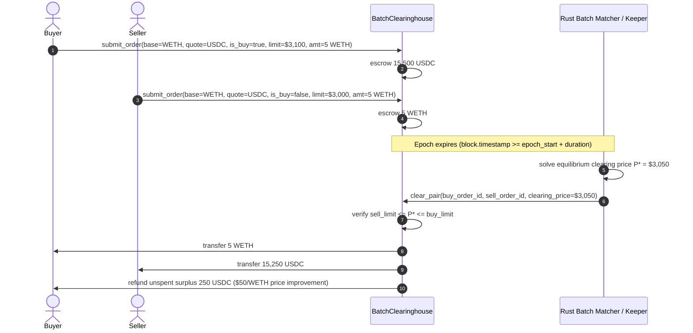

# Aegis Frequent Batch Auction Clearinghouse

Continuous automated market makers (AMMs) and continuous limit order books (CLOBs) suffer from structural latency arbitrage and toxic MEV. High-frequency arbitrageurs exploit nanosecond ordering differences, frontrunning retail and institutional traders via sandwich attacks. Aegis eliminates these vectors through `BatchClearinghouse.vy`, an onchain Frequent Batch Auction (FBA) clearinghouse.

---

## 1. Market Design: Continuous vs. Frequent Batch Trading

In their foundational work (*The High-Frequency Trading Arms Race: Frequent Batch Auctions as a Market Design Response*, Budish et al., 2015), market design theorists demonstrated that treating time as continuous creates a prisoner's dilemma where liquidity providers widen spreads to compensate for adverse selection.

```
Continuous Trading (MEV Fragile):
Time:  t=0.0001s --------> t=0.0002s --------> t=0.0003s
Order: [Sniper Buy]        [Trader Swap]       [Sniper Sell]  <--- Toxic Sandwich!

Frequent Batch Auction (Aegis):
Batch Duration: [================= Epoch T =================]
Orders:         [Buy @ $3,050] [Sell @ $3,000] [Buy @ $3,020]
                                  |
                                  v
                Uniform Clearing Price: P* = $3,020
                Zero Frontrunning / Zero Latency Advantage
```

By discretizing time into finite epochs (e.g., 60 seconds), all orders received within the window are treated as strictly simultaneous. Intra-batch transaction positioning provides zero economic advantage.

---

## 2. Onchain Settlement Mechanism

The clearinghouse processes two-sided limit orders across discrete epochs:



---

## 3. Mathematical Equilibrium & Uniform Pricing

Let $\mathcal{B} = \{b_1, \dots, b_k\}$ be the set of buy orders and $\mathcal{S} = \{s_1, \dots, s_m\}$ be the set of sell orders for a given asset pair. Each order specifies:
- Limit price $p_i$.
- Base token volume $q_i$.

### 3.1 Demand and Supply Functions

The aggregate demand function $D(p)$ and aggregate supply function $S(p)$ are defined by:

$$D(p) = \sum_{b \in \mathcal{B}: p_b \ge p} q_b$$

$$S(p) = \sum_{s \in \mathcal{S}: p_s \le p} q_s$$

$D(p)$ is a weakly decreasing step function; $S(p)$ is a weakly increasing step function.

```
Price (P)
  ^
  |        \ Demand D(P)          / Supply S(P)
  |         \                    /
P*|----------\------------------/----------- Uniform Clearing Price
  |           \                /
  |            \              /
  |             \            /
  +-------------------------------------> Quantity (Q)
                 Q* = min(D(P*), S(P*))
```

### 3.2 Uniform Clearing Price Theorem

The uniform clearing price $P^*$ is selected such that matched volume is maximized:

$$P^* = \arg\max_p \min(D(p), S(p))$$

Subject to the constraint:
$$p_s \le P^* \le p_b \quad \forall \text{ matched orders } (b, s)$$

Every matched buyer pays exactly $P^*$, and every matched seller receives exactly $P^*$.

### 3.3 Consumer Surplus & Refund Mechanics

When a buyer submits a bid with $P_{\text{bid}} > P^*$, the buyer escrows quote assets corresponding to their maximum limit price:

$$\text{Escrow}_{\text{quote}} = Q \cdot P_{\text{bid}}$$

Upon batch clearing at price $P^*$, the actual cost is only:

$$\text{Cost}_{\text{actual}} = Q \cdot P^*$$

`BatchClearinghouse.vy` automatically computes the residual surplus:

$$\text{Refund}_{\text{quote}} = Q \cdot (P_{\text{bid}} - P^*)$$

and transfers the refunded surplus quote tokens back to the buyer's balance in the same transaction, providing guaranteed price improvement.

---

## 4. Offchain Rust Solver (`native/src/lib.rs`)

To achieve maximum computational efficiency, the multi-order clearing equilibrium is computed offchain by the accelerated Rust matching engine and submitted to the blockchain:

1. **Sorting**: Orders are partitioned into Bids (sorted descending by limit price) and Asks (sorted ascending by limit price).
2. **Intersection Scan**: In $O(N \log N)$ time, the algorithm computes cumulative volume steps to identify crossed volume $Q^*$ and the equilibrium midpoint price.
3. **Onchain Verification**: `BatchClearinghouse.vy` independently validates that $p_s \le P^* \le p_b$ for each crossed pair before moving escrowed tokens, ensuring keepers cannot manipulate prices.
