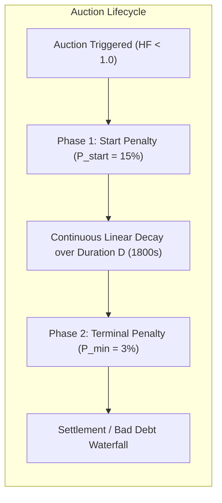

# Aegis Continuous Dutch Auction Mechanism

Liquidation mechanisms in decentralized finance represent one of the primary surfaces for Miner-Extractable Value (MEV), toxic orderflow, and borrower equity destruction. Aegis replaces discrete fixed-bounty liquidations with a continuous decaying Dutch auction protocol (`LiquidationAuction.vy`).

---

## 1. The MEV Problem in Fixed-Bounty Liquidations

In conventional money markets, liquidators are granted a fixed percentage discount (typically 5% to 10%) on seized collateral:

```
[Borrower Insolvent] ---> [Fixed 10% Bounty Unlocked]
                                    |
          +-------------------------+-------------------------+
          |                                                   |
          v                                                   v
   [Searcher A: 90 Gwei]                             [Searcher B: 150 Gwei]
          \                                                   /
           \                                                 /
            +------------> [Priority Gas Auction] <---------+
                                    |
                                    v
                     [Miner / Builder Captures 99%
                          of Borrower Margin]
```

Under this regime:
1. **Zero Price Discovery**: The protocol pays the maximum penalty even when market liquidity would clear the collateral for a 0.5% haircut.
2. **Value Leakage to Block Builders**: Searchers bid away up to 99% of the liquidation bonus in priority gas fees (PGAs) or private MEV-Boost bribes, transferring borrower equity directly to validators.
3. **Cascading Insolvency**: During sudden market drawdowns, mempool congestion delays transactions, causing underwater accounts to accrue bad debt before any liquidation executes.

---

## 2. Decaying Dutch Auction Mechanism

Aegis implements a continuous two-phase Dutch auction that dynamically adjusts the liquidation penalty over time based on elapsed blocks:



### 2.1 Formal Mathematical Formulation

When an account is flagged with $HF < 1.0 \times 10^{18}$, `CreditManager` invokes `start_auction()` on `LiquidationAuction.vy`:
- $T_0$: Unix timestamp of auction creation.
- $D$: Configured auction duration (default 1,800 seconds / 30 minutes).
- $P_{\text{start}}$: Initial penalty rate (15% in WAD, $0.15 \times 10^{18}$).
- $P_{\text{min}}$: Minimum baseline penalty rate (3% in WAD, $0.03 \times 10^{18}$).

For any current timestamp $t \ge T_0$, the elapsed duration is:

$$\Delta t = \min(t - T_0, D)$$

The active penalty $P(t)$ is computed via integer fixed-point linear interpolation:

$$P(t) = P_{\text{start}} - \left( \frac{\Delta t \cdot (P_{\text{start}} - P_{\text{min}})}{D} \right)$$

### 2.2 Collateral Settlement Calculation

When a liquidator covers a debt amount $D_{\text{covered}}$:

1. **Normalized Debt Value (USD)**:
   $$V_{\text{debt\_usd}} = \frac{D_{\text{covered}} \cdot P_{\text{debt\_oracle}}}{10^{18}}$$

2. **Liquidator Collateral Entitlement (USD)**:
   $$V_{\text{collat\_usd}} = \frac{V_{\text{debt\_usd}} \cdot (10^{18} + P(t))}{10^{18}}$$

3. **Seized Collateral Amount**:
   $$C_{\text{seized}} = \min\left( \frac{V_{\text{collat\_usd}} \cdot 10^{18}}{P_{\text{collat\_oracle}}}, \; C_{\text{total}} \right)$$

Residual collateral $C_{\text{residual}} = C_{\text{total}} - C_{\text{seized}}$ remains in the `CreditAccount` proxy and is preserved for the original borrower once debt is fully covered.

---

## 3. Game-Theoretic Equilibrium

The continuous Dutch auction alters the strategic payoff matrix for MEV searchers and programmatic liquidators:

```
Liquidation Profit = Collateral Value Acquired - Debt Repaid - Gas Costs
```

$$\Pi(t) = D_{\text{covered}} \cdot P(t) - \text{ExecutionCost}$$

If a liquidator attempts to delay execution in hopes of a wider spread, competitor searchers monitoring the mempool will front-run and execute as soon as the penalty covers their hurdle rate plus execution cost:

$$P^*(t) \approx \text{Slippage}(\text{DEX}) + \text{GasFee} + \epsilon$$

In liquid markets with deep liquidity, liquidations clear rapidly within the early window, preserving up to 80% more equity for borrowers compared to fixed 10% penalty architectures.

---

## 4. Partial Liquidation & Health Restoration

To minimize unnecessary liquidation churn, Aegis supports partial liquidations:
- A liquidator is not required to repay 100% of the account debt.
- Liquidators can repay a targeted fraction $D_{\text{covered}} \le D_{\text{total}}$ sufficient to push the account's Health Factor back above $1.05 \times 10^{18}$.
- Once the health factor reaches safe thresholds, the auction is settled, closing the liquidation state without liquidating the remainder of the borrower's portfolio.

---

## 5. Circuit Breaker Integration

In the event of black-swan oracle anomalies or exchange pauses:
1. `EmergencyCouncil.vy` can invoke `pause_auction(auction_id)` immediately without timelock delays.
2. While paused, no collateral may be seized or debt settled.
3. Once market stability is re-established, the auction duration can be extended or resumed under updated parameters.
