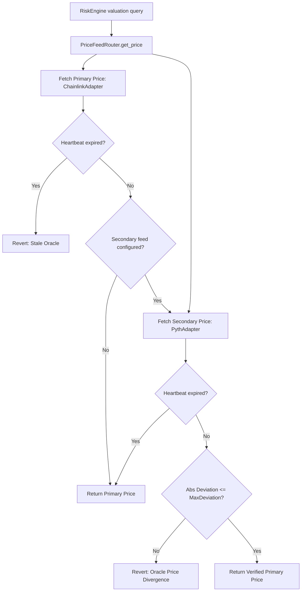

# Aegis Risk Model & Margin Engine

The Aegis Risk Engine (`RiskEngine.vy`) implements a cross-margin multi-asset risk framework designed for decentralized prime brokerage. The engine evaluates real-time collateralization across diverse asset baskets, applying non-linear risk haircuts and liquidation thresholds to protect the protocol against adverse market volatility.

---

## 1. Mathematical Formalism

Let an active `CreditAccount` hold a vector of spot collateral balances:

$$\vec{c} = (c_1, c_2, \dots, c_n)$$

and a vector of outstanding debt liabilities:

$$\vec{d} = (d_1, d_2, \dots, d_m)$$

Let $\vec{p}$ denote the vector of real-time USD asset prices provided by `PriceFeedRouter.vy`, normalized to 18-decimal fixed-point WAD ($10^{18}$):

$$p_k = \text{OraclePrice}(\text{Asset}_k)$$

### 1.1 Raw Collateral and Debt Valuation

The unweighted mark-to-market valuation of total collateral $V_{\text{collateral}}$ and total debt $V_{\text{debt}}$ is defined by:

$$V_{\text{collateral}} = \sum_{i=1}^n c_i \cdot p_i$$

$$V_{\text{debt}} = \sum_{j=1}^m d_j \cdot p_j$$

### 1.2 Risk-Adjusted Borrowing Capacity

Each supported collateral asset $i$ is assigned a collateral haircut $h_i \in (0, 1]$, expressed in basis points ($10^4$):

$$V_{\text{adj}} = \sum_{i=1}^n c_i \cdot p_i \cdot h_i$$

For any state mutation that increases the debt liability of the account (such as `borrow()` or `withdraw()`), the account must satisfy the initial margin requirement:

$$\text{BorrowCapacity} = V_{\text{adj}} - V_{\text{debt}} \ge 0$$

$$\iff \frac{V_{\text{adj}}}{V_{\text{debt}}} \ge 1.0 \times 10^{18}$$

### 1.3 Maintenance Margin and Health Factor

Each collateral asset is also assigned a liquidation threshold $lt_i$, where $h_i < lt_i \le 1.0$. The liquidation value $V_{\text{liq}}$ reflects the maximum acceptable debt supportable by the portfolio:

$$V_{\text{liq}} = \sum_{i=1}^n c_i \cdot p_i \cdot lt_i$$

The protocol Health Factor ($HF$) is evaluated continuously onchain:

$$HF = \frac{V_{\text{liq}}}{V_{\text{debt}}} = \frac{\sum_{i=1}^n c_i \cdot p_i \cdot lt_i}{\sum_{j=1}^m d_j \cdot p_j}$$

The operational state of the account is governed by $HF$:

| Health Factor Range | Status | Permitted Operations |
| :--- | :--- | :--- |
| $HF \ge 1.25$ | Safe / Optimal | Full operational freedom: borrow, withdraw excess collateral, trade. |
| $1.00 \le HF < 1.25$ | Warning Zone | Margin call warning. No further borrowing allowed. Collateral withdrawal locked. Trades must be de-risking. |
| $HF < 1.00$ | Insolvent / Liquidatable | Account seized. Liquidator auction initiated via `LiquidationAuction.vy`. |

---

## 2. Risk Parameters and Calibration Matrix

Risk parameters are configured in `ProtocolParameters.vy` and enforced dynamically by `RiskEngine.vy`. Parameters are calibrated based on asset volatility, liquidity depth, and historical slippage distributions:

| Asset | Base Haircut ($h_i$) | Liquidation Threshold ($lt_i$) | Liquidation Spread ($\Delta = lt_i - h_i$) | Max Position Cap |
| :--- | :--- | :--- | :--- | :--- |
| **USDC** | 95.0% (9,500 bps) | 98.0% (9,800 bps) | 3.0% (300 bps) | $50,000,000 |
| **USDT** | 95.0% (9,500 bps) | 98.0% (9,800 bps) | 3.0% (300 bps) | $50,000,000 |
| **WETH** | 85.0% (8,500 bps) | 90.0% (9,000 bps) | 5.0% (500 bps) | $25,000,000 |
| **WBTC** | 80.0% (8,000 bps) | 85.0% (8,500 bps) | 5.0% (500 bps) | $20,000,000 |

### 2.1 The Safety Buffer Margin ($\Delta$)

The spread between the liquidation threshold and initial haircut $\Delta_i = lt_i - h_i$ creates a deterministic safety buffer. For WETH:
- Initial borrow requires $V_{\text{debt}} \le 0.85 \times V_{\text{WETH}}$.
- Liquidation does not trigger until $V_{\text{debt}} > 0.90 \times V_{\text{WETH}}$.

This 5.0% buffer absorbs normal intraday market noise and transient volatility spikes without triggering premature liquidations or unnecessary transaction churn for traders.

---

## 3. Real-Time Oracle Verification

`RiskEngine.vy` accesses asset valuations exclusively through `PriceFeedRouter.vy`. To ensure price integrity under extreme volatility and prevent flash loan manipulation:

### Staleness and Circuit Breakers
1. **Heartbeat Bounds**: Chainlink feeds must update within a maximum acceptable window (typically 3,600s for standard feeds, 120s for fast feeds).
2. **Deviation Clamping**: If primary and secondary oracles diverge by more than the configured basis point limit (e.g., 200 bps / 2%), the router flags potential manipulation and reverts execution, freezing affected margin mutations until consistency returns.

---

## 4. Multi-Asset Cross-Margin Offsetting

Unlike siloed money markets where each lending pair is isolated, Aegis evaluates the entire net portfolio:

$$\text{NetPortfolioEquity} = V_{\text{collateral}} - V_{\text{debt}}$$

If a trader deposits 10 WETH and borrows 20,000 USDC to buy 6.66 additional WETH on Uniswap V3, the credit account proxy holds:
- Collateral: 16.66 WETH
- Debt: 20,000 USDC

At $P_{\text{ETH}} = \$3,000$:
- $V_{\text{collateral}} = 16.66 \times 3,000 = \$49,980$
- $V_{\text{debt}} = 20,000 \times 1.0 = \$20,000$
- $V_{\text{liq}} = \$49,980 \times 0.90 = \$44,982$
- $HF = \frac{\$44,982}{\$20,000} = 2.249 \quad (\text{Safe})$

If $P_{\text{ETH}}$ drops to $\$1,300$:
- $V_{\text{collateral}} = 16.66 \times 1,300 = \$21,658$
- $V_{\text{liq}} = \$21,658 \times 0.90 = \$19,492.20$
- $HF = \frac{\$19,492.20}{\$20,000} = 0.9746 < 1.00$

The account automatically enters the liquidation state.
