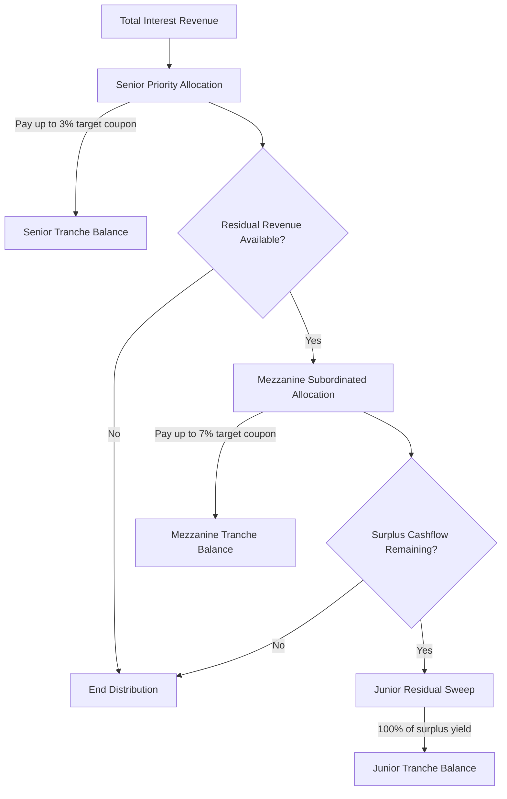
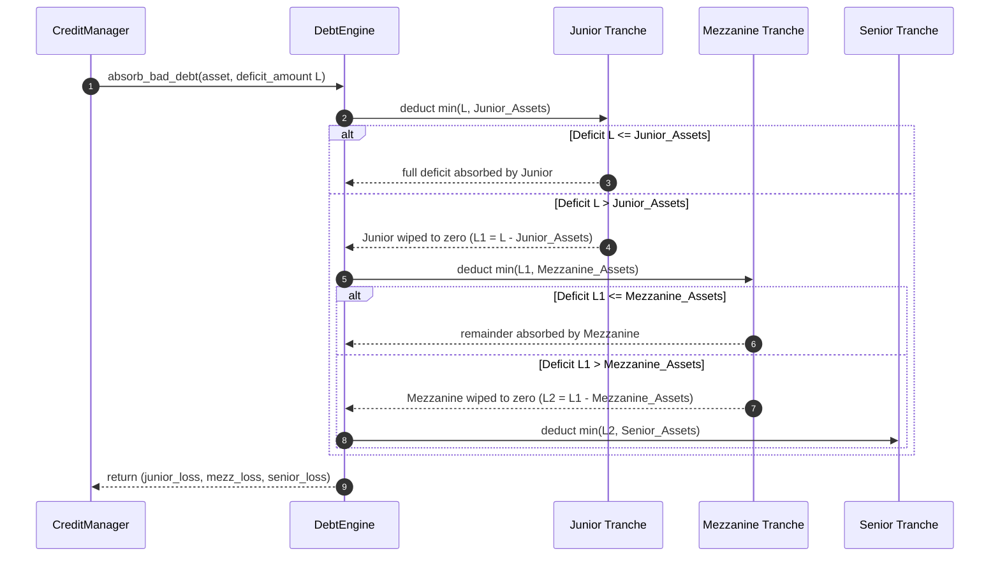

# Aegis DebtEngine Tranche Waterfall & Interest Accounting

The Aegis Debt Engine (`DebtEngine.vy`) introduces structured finance mechanics into decentralized lending. By segmenting deposited liquidity into distinct risk tranches, Aegis provides tailored risk-return profiles for depositors while establishing a programmatic loss absorption buffer against credit defaults.

---

## 1. Capital Tranche Structure

Deposited capital within each asset market is segregated into three risk tranches:

```
+=============================================================================+
|                      SENIOR TRANCHE (AAA Priority)                          |
|  - First claim on accrued interest cashflows                                |
|  - Target fixed coupon: 3.0% annualized pro-rata                            |
|  - Last to absorb default losses                                            |
+=============================================================================+
                                      |
                                      v
+=============================================================================+
|                    MEZZANINE TRANCHE (BBB Priority)                         |
|  - Second claim on accrued interest cashflows                               |
|  - Target subordinated coupon: 7.0% annualized pro-rata                     |
|  - Absorbs losses after Junior tranche is completely wiped out              |
+=============================================================================+
                                      |
                                      v
+=============================================================================+
|                      JUNIOR TRANCHE (First-Loss Equity)                     |
|  - Receives 100% of residual yield surplus (variable upside)                |
|  - Absorbs 100% of initial bad debt losses                                  |
|  - Protects Senior and Mezzanine depositors                                 |
+=============================================================================+
```

### 1.1 Tranche Allocation Profile

| Tranche ID | Risk Class | Loss Seniority | Yield Priority | Target Depositor Profile |
| :--- | :--- | :--- | :--- | :--- |
| `0` (Senior) | AAA | Junior-most priority (3rd) | 1st Priority (3% Coupon) | Risk-averse institutions, treasuries, conservative LPs |
| `1` (Mezzanine) | BBB | Intermediate priority (2nd) | 2nd Priority (7% Coupon) | Balanced yield seekers |
| `2` (Junior) | Equity | First-loss priority (1st) | Residual Spread (Variable 15%+)| High-yield seekers, protocol underwriters |

---

## 2. Dynamic Jump Rate Model

Aegis models borrowing interest rates via a continuous two-slope kinked jump rate curve. The curve ensures low, predictable borrowing costs during normal conditions, but jumps steeply once pool utilization exceeds the target optimal utilization threshold.

### 2.1 Formal Formulation

Let $U(t)$ represent current asset pool utilization:

$$U(t) = \frac{\text{TotalBorrowedAssets}(t)}{\text{TotalSuppliedAssets}(t)}$$

Let $U_{\text{kink}}$ denote the inflection point (default $80.0\% = 0.8 \times 10^{18}$):
- $R_{\text{base}}$: Base borrow rate at zero utilization (default $2.0\%$).
- $R_{\text{slope1}}$: Gradual slope below kink (default $4.0\%$).
- $R_{\text{slope2}}$: Steep penalty jump above kink (default $60.0\%$).

The instantaneous annual borrow rate $R(U)$ is defined by:

$$R(U) = \begin{cases} 
R_{\text{base}} + \left( \frac{U}{U_{\text{kink}}} \right) \cdot R_{\text{slope1}}, & \text{if } U \le U_{\text{kink}} \\
R_{\text{base}} + R_{\text{slope1}} + \left( \frac{U - U_{\text{kink}}}{1.0 - U_{\text{kink}}} \right) \cdot R_{\text{slope2}}, & \text{if } U > U_{\text{kink}}
\end{cases}$$

```
Borrow Rate R(U)
     ^
     |                                      / (U=100%, R=66%)
 66% |                                     /
     |                                    /  Slope 2 (Jump)
     |                                   /
  6% |                   ---------------+ (U=80%, R=6%)
     |                 /  Slope 1
  2% |---------------+
     +----------------------------------------> Utilization U
     0%             80% (Kink)             100%
```

### 2.2 Compounding and Index Accrual

Interest accrual is computed continuously across discrete blocks using standard Ray ($10^{27}$) arithmetic. For an elapsed time $\Delta t = t - t_{\text{last}}$:

$$I_{\text{rate\_ray}} = \frac{R(U) \cdot 10^9}{\text{SECONDS\_PER\_YEAR}}$$

$$\text{BorrowIndex}_{\text{ray}}(t) = \text{BorrowIndex}_{\text{ray}}(t_{\text{last}}) \cdot \left( 1.0 + \frac{I_{\text{rate\_ray}} \cdot \Delta t}{10^{27}} \right)$$

Individual borrower debt scales proportionally with the global borrow index:

$$\text{Debt}(t) = \text{Principal} \cdot \frac{\text{BorrowIndex}_{\text{ray}}(t)}{\text{BorrowIndex}_{\text{ray}}(t_{\text{entry}})}$$

---

## 3. Cashflow Distribution Waterfall

When borrowers repay debt or periodic interest accrues on outstanding loans, the incoming cashflow $I_{\text{revenue}}$ is routed through `distribute_waterfall()`:



### 3.1 Payout Precedence

1. **Senior Tranche Priority**:
   $$I_{\text{senior}} = \min(I_{\text{revenue}}, \; P_{\text{senior}} \cdot 0.03)$$
   $$\text{Remainder}_1 = I_{\text{revenue}} - I_{\text{senior}}$$

2. **Mezzanine Tranche Priority**:
   $$I_{\text{mezz}} = \min(\text{Remainder}_1, \; P_{\text{mezz}} \cdot 0.07)$$
   $$\text{Remainder}_2 = \text{Remainder}_1 - I_{\text{mezz}}$$

3. **Junior Equity Sweep**:
   $$I_{\text{junior}} = \text{Remainder}_2$$

Under this waterfall, junior depositors earn amplified yield during high protocol utilization periods, compensating them for bearing primary credit risk.

---

## 4. Programmatic Bad Debt Absorption

When an underwater credit account cannot be liquidated profitably due to extreme market gap risk, the resulting liquidation deficit (bad debt $L$) is absorbed sequentially via `absorb_bad_debt()`:



### 4.1 Formal Loss Invariant

Senior tranche principal $P_{\text{senior}}$ is guaranteed immutable unless both junior and mezzanine capital buffers are completely exhausted:

$$\Delta P_{\text{senior}} > 0 \iff P_{\text{junior}} = 0 \land P_{\text{mezz}} = 0$$

Empirical simulations across 500 Merton jump-diffusion stress paths indicate that even during severe 45% black swan market crashes, senior tranche depositors experience 100% principal recovery.
